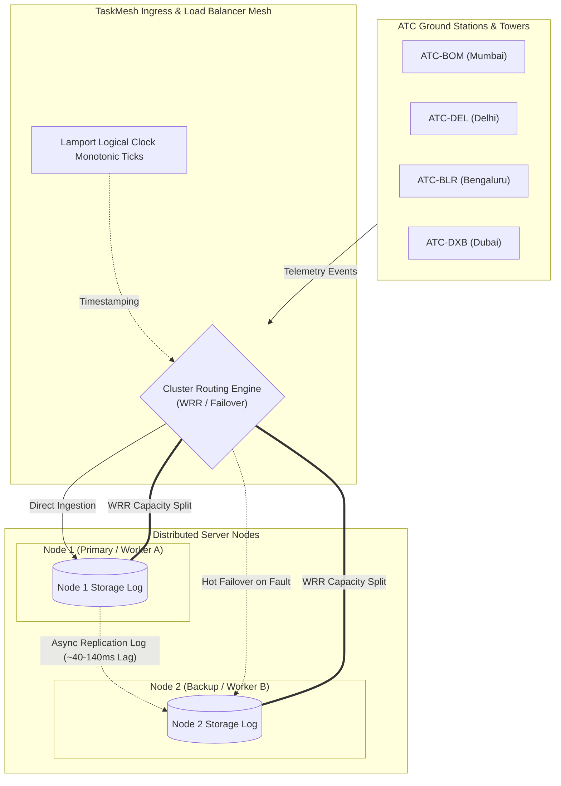

<div align="center">

# ✈️ TaskMesh ATC: Distributed Telemetry Mesh & Fault-Tolerant Cluster

**A high-reliability distributed cluster coordinator for real-time Air Traffic Control telemetry, dynamic task load balancing, and automated disaster failover.**

🔗 **Live Demo (GitHub Pages):** [https://ashmit-patil.github.io/atc-taskmesh-monitor/](https://ashmit-patil.github.io/atc-taskmesh-monitor/)  
📦 **Repository:** [https://github.com/Ashmit-Patil/atc-taskmesh-monitor](https://github.com/Ashmit-Patil/atc-taskmesh-monitor)

[](LICENSE)
[]()
[]()
[-brightgreen.svg)]()

</div>

---

## 📌 Executive Summary

Modern Air Traffic Control (ATC) infrastructure demands sub-second event coordination across distributed ground radar stations, approach control sectors, and flight operations databases. Single points of failure in ATC coordinator servers present unacceptable safety risks.

**TaskMesh ATC** is a production-grade distributed systems dashboard and cluster simulator. It models how distributed telemetry streams are routed, balanced, and preserved under severe node faults using formal distributed computing principles:
- **Primary-Backup Fault Tolerance & Delta Reconciliation** (Warm/Hot standby failover with zero lost updates).
- **Dynamic Task Scheduling** (Smooth Weighted Round-Robin and uniform Round-Robin load distribution).
- **Event Ordering via Lamport Logical Clocks** to ensure causality across asynchronous multi-tower events.
- **Side-by-Side Replication Observability** showing dynamic replication latency, provenance tags, and delta backfill progress.

---

## 🏗️ System Architecture



---

## ⚡ Core Distributed Computing Concepts Implemented

### 1. Primary-Backup Replication & Disaster Failover (Active-Passive)
- **Normal Operation:** Primary Node (`Node-A`) accepts direct telemetry ingress and asynchronously replicates log entries to Replica Node (`Node-B`) with measured replication lag ($\Delta t \approx 40\text{--}140\text{ ms}$).
- **Failover Induction:** Crashing Node 1 automatically triggers an immediate failover election. The coordinator switches ingestion traffic to Node 2 without dropping packets.
- **Delta Reconciliation (Recovery Sync):** When Node 1 boots back up, it does not immediately assume leader duties. Instead, it enters a `SYNCING` state, pulling the missing delta slice accumulated during downtime from Node 2. Once identical cluster state is restored, Node 1 is re-promoted to Primary.

### 2. Smooth Weighted Round-Robin (WRR) Task Scheduling (Active-Active)
- In active-active mode, both nodes participate as active task executors.
- Implements Nginx-style **Smooth Weighted Round Robin**:
  $$\text{Share}_{\text{Node } i} = \frac{W_i}{\sum_{k} W_k}$$
  For example, with a configured ratio of $3:1$, Node 1 executes $75\%$ of ingress telemetry and Node 2 executes $25\%$, verified empirically on live split meters.
- **Node Eviction:** If an individual worker node crashes during load balancing, the scheduler evicts the degraded node and routes $100\%$ of traffic to healthy survivors.

### 3. Event Causality & Lamport Logical Clocks
- Distributed events generated across disjoint ATC sectors lack physical synchronized clocks.
- Each telemetry ingestion increments a monotonic Lamport Logical Clock counter (`LC: #N`), ensuring a strict partial order of distributed events ($e_a \to e_b \implies L(e_a) < L(e_b)$).

### 4. Telemetry Stream Filtering with Replication Decoupling
- Real-time client-side queries by **Sector ATC**, **Origin Hub**, **Destination Hub**, or **Flight Type** filter the visible strip rack without disturbing the node partitions, preserving full database replicas across both servers.

---

## 🖥️ Live Telemetry Dashboard Features

| Component | Description |
| :--- | :--- |
| **Cluster Health & Telemetry Bar** | Live monitor displaying cluster status (`HEALTHY`, `DEGRADED`, `CRITICAL`), ingress rate (req/s), real-time replication latency (ms), and Lamport clock ticks. |
| **ATC Flight Progress Strips** | Industry-standard ATC radar progress cards with airline identifiers, route vectors, destination hubs, scheduled landing towers, and storage cluster tags. |
| **Dual Server Partition Tables** | Side-by-side inspection of Node 1 and Node 2 disk partitions, timestamps, and ingestion provenance tags (`primary ingest`, `replica +XXms`, `reconciled sync`, `wrr schedule`). |
| **Interactive Chaos Controls** | Dedicated triggers to crash/restore individual nodes, pause telemetry streams, toggle between Failover and Load Balancing modes, and adjust WRR capacity weights on the fly. |
| **Monotonic Cluster Audit Log** | Millisecond-precision system log recording leader elections, replication heartbeats, and cluster state reconciliations. |

---

## 🚀 Quick Start Guide

### Direct Browser Execution (No dependencies required)
Simply double click `index.html` or run:
```powershell
Start-Process index.html
```

### Local Dev Server
```bash
# Clone the repository
git clone https://github.com/Ashmit-Patil/atc-taskmesh-monitor.git

# Enter project directory
cd atc-taskmesh-monitor

# Run with any static server (Node serve, Python, etc.)
npx serve .
# Or: python -m http.server 3000
```
Then visit **`http://localhost:3000`** in your browser.

---

## 🧪 Demonstration & Lab Evaluation Steps

### Demonstration 1: Disaster Failover & Recovery Catch-Up
1. Ensure **Routing Mode** is set to `Fault-Tolerant Failover (Active-Passive)`.
2. Observe flights arriving on Node 1 (Primary) and asynchronously copying to Node 2 with sub-second replication latency.
3. Click **Crash Primary (S1)**. Notice:
   - Primary turns offline.
   - Failover banner alerts that Node 2 has been promoted to ingress leader.
   - New incoming flight strips now mark storage on **Node 2**.
4. Click **Restore & Sync S1**. Notice:
   - Node 1 enters the `SYNCING` state with an animated catch-up progress bar.
   - All records ingested during the outage are backfilled into Node 1's table (`reconciled sync`).
   - Cluster status returns to `HEALTHY`.

### Demonstration 2: Dynamic Task Load Balancing
1. Change **Routing Mode** to `Task Load Balancing (Active-Active)`.
2. Configure **Capacity Weight** (default `3:1`).
3. Observe live split bars converge precisely toward $75\%$ on Node 1 and $25\%$ on Node 2.
4. Switch **Scheduler Algorithm** to `Standard Round Robin (RR)`: observe the split dynamically equilibrate to $50\% / 50\%$.
5. Click **Crash Node S1**: the scheduler detects node eviction and routes $100\%$ of new flights to Node 2 without interrupting service.

---

## 🔌 Architecture Extensibility (Pluggable Backend)

The frontend uses an internal decoupled **Event-Bus Architecture**:

```javascript
bus.on('flight_created', ({ flight }) => { ... });
bus.on('record_stored',  ({ server, record }) => { ... });
bus.on('server_status',  ({ server, status }) => { ... });
bus.on('sync_progress',  ({ copied, remaining }) => { ... });
```

To connect to a live backend (such as Go, Python FastAPI, Apache Kafka, or Socket.IO), simply replace the simulator emitter in `index.html` with your WebSocket message stream. The UI requires zero code modifications.

---

## 📜 License

Distributed under the [MIT License](LICENSE).
